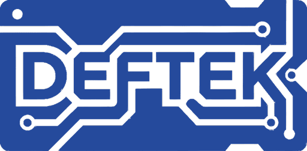
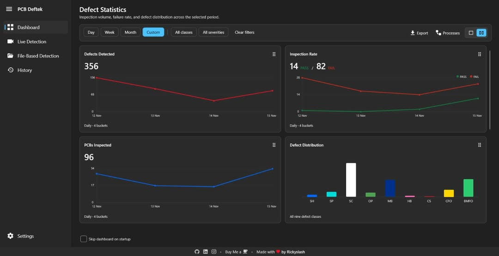
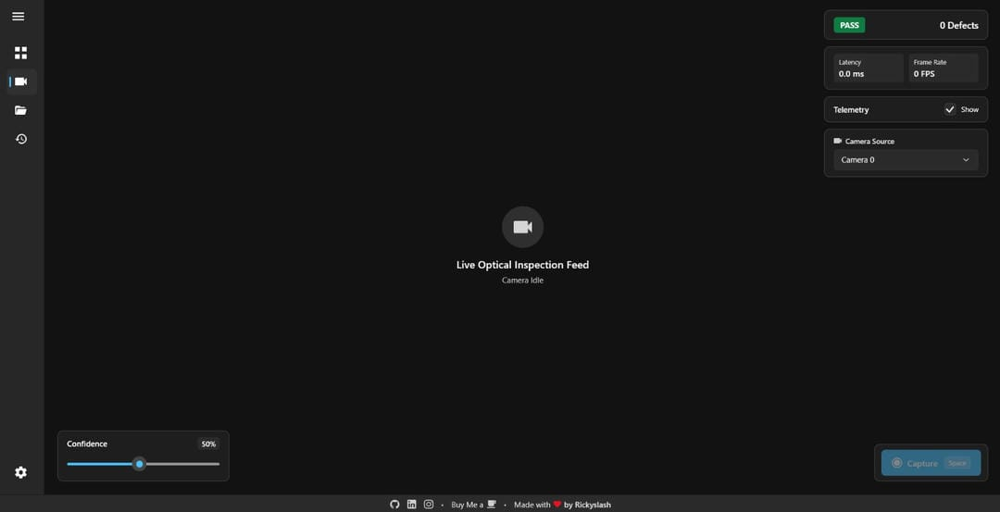
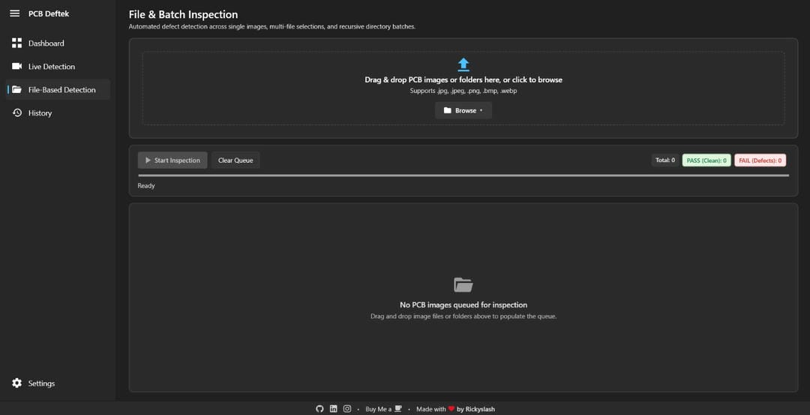

<p align="center">
  
</p>

<h1 align="center">PCB Deftek</h1>

<p align="center">
  <a href="https://github.com/ricky-kiva/pcb-deftek/actions/workflows/ci.yml"></a>
</p>

Automated PCB defect detection and analysis for Windows. PCB Deftek inspects boards with an ONNX YOLO detector, localizes and classifies trace defects, stores inspection evidence in SQLite, and produces audit-ready PDF reports.

> **Detection scope:** This application is specifically designed to detect PCB trace defects (e.g., open circuits and short circuits). It is best suited for bare PCBs without mounted components.

## Features

- **Nine defect classes** — Short (SH), Open (OP), Mouse bite (MB), Spur (SP), Spurious copper (SC), Hole breakout (HB), Conductor scratch (CS), Conductor foreign object (CFO), Base material foreign object (BMFO).
- **Live camera inspection** — full-screen viewport with bounding-box overlays, PASS/FAIL badge, defect counter, optional latency/FPS telemetry, confidence slider, `Space` capture, and idle auto-hide.
- **File and batch detection** — drag-and-drop single files, multi-selection, or whole folders with per-batch progress and inline ETA.
- **Inspection history** — date-grouped gallery, PASS/FAIL badges, filters, inline rename, multi-select deletion, and an interactive pan/zoom viewer with defect diagnostics and viewport cropping.
- **Statistics dashboard** — date/class/severity filters, four metric cards with interactive charts, drag-and-drop card ordering, and defect knowledge cards.
- **Audit-ready PDF export** — filtered metric summary plus annotated evidence images and three-column defect tables, written to `Downloads\PCB Deftek\Report`.
- **Settings** — confidence threshold, CPU/GPU device selection, startup page, report/image output locations, and database backup/export.

## Screenshots

### Dashboard



### Live Detection



### File Detection



### History


## Prerequisites

- Windows 10 or 11, x64
- [.NET 10 SDK](https://dotnet.microsoft.com/download) (build) or the .NET 10 Desktop Runtime (run a published build)
- Optional: a webcam for Live Detection
- Optional: a DirectML-capable GPU for hardware-accelerated inference (falls back to CPU)

## Getting started

```powershell
dotnet restore
dotnet build pcb-deftek.slnx -c Release
dotnet run --project pcb-deftek.csproj
```

The inference model ships with the repository at `Assets/Models/best.onnx` and is copied to the build output automatically.

## Tests

```powershell
dotnet test pcb-deftek.slnx
```

- `tests/pcb-deftek.Tests` — xUnit unit and SQLite integration tests.
- `tests/pcb-deftek.Bdd` — Reqnroll acceptance scenarios against real services with isolated databases.

Every test creates its own SQLite database, capture folder, and export folder under the system temp directory. Tests never read or write `%LOCALAPPDATA%\PcbDeftek` or the user's Downloads folder.

## Data and logs

| Purpose | Location |
|---|---|
| Database | `%LOCALAPPDATA%\PcbDeftek\pcb-deftek\app.db` |
| Logs (Serilog, 30 files retained) | `%LOCALAPPDATA%\PcbDeftek\pcb-deftek\logs` |
| Live capture images | `%LOCALAPPDATA%\PcbDeftek\pcb-deftek\Captures` |
| PDF reports | `Downloads\PCB Deftek\Report` |
| Database backups/exports | `Downloads\PCB Deftek\Backup` |
| Cropped images | `Downloads\PCB Deftek\Images` |

Report, backup, and image folders are configurable in Settings. User-owned source images are never modified or deleted; cleanup is limited to records and app-owned capture files.

## Project documentation

- Product scope: [`specs/mission.md`](specs/mission.md)
- Stack and constraints: [`specs/tech-stack.md`](specs/tech-stack.md)
- Roadmap: [`specs/roadmap.md`](specs/roadmap.md)
- Per-phase plans, requirements, and validation: [`specs/`](specs/)

## License

GNU General Public License v3.0 — see [`LICENSE.txt`](LICENSE.txt).
