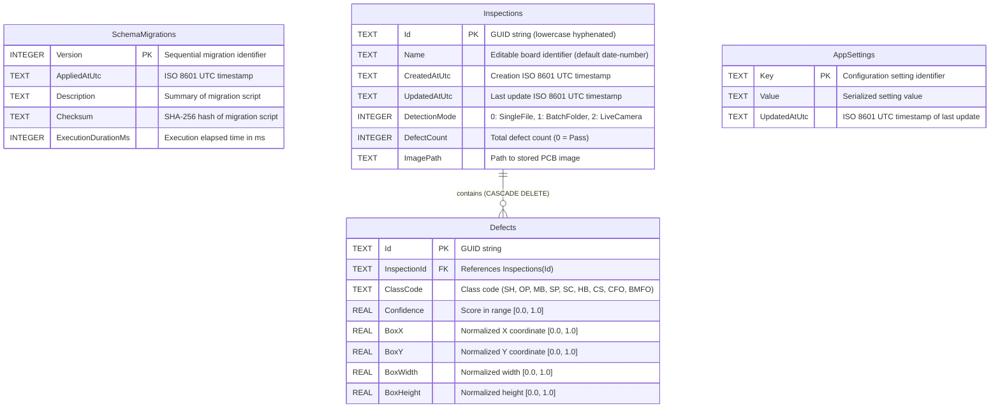

# Database Entity-Relationship Diagram (ERD) & Migration Architecture: Phase 2

This document defines the streamlined SQLite physical schema, constraints, indices, domain mapping contracts, and the bidirectional migration lifecycle in accordance with `api-and-interface-design` and `deprecation-and-migration`.



---

## Physical Table DDL & Integrity Constraints

```sql
-- Schema Migration Tracking (Auditable, Idempotent, Tamper-Evident)
CREATE TABLE IF NOT EXISTS SchemaMigrations (
    Version INTEGER PRIMARY KEY,
    AppliedAtUtc TEXT NOT NULL,
    Description TEXT NOT NULL,
    Checksum TEXT NOT NULL,
    ExecutionDurationMs INTEGER NOT NULL
);

-- Inspections Table (Streamlined)
CREATE TABLE IF NOT EXISTS Inspections (
    Id TEXT PRIMARY KEY,
    Name TEXT NOT NULL,
    CreatedAtUtc TEXT NOT NULL,
    UpdatedAtUtc TEXT NOT NULL,
    DetectionMode INTEGER NOT NULL CHECK (DetectionMode IN (0, 1, 2)),
    DefectCount INTEGER NOT NULL DEFAULT 0 CHECK (DefectCount >= 0),
    ImagePath TEXT NOT NULL
);

CREATE INDEX IF NOT EXISTS IX_Inspections_CreatedAtUtc ON Inspections(CreatedAtUtc DESC);
CREATE INDEX IF NOT EXISTS IX_Inspections_DetectionMode ON Inspections(DetectionMode);

-- Defects Table (Normalized - Diagnostic metadata provided by DefectClassCatalog)
CREATE TABLE IF NOT EXISTS Defects (
    Id TEXT PRIMARY KEY,
    InspectionId TEXT NOT NULL,
    ClassCode TEXT NOT NULL,
    Confidence REAL NOT NULL CHECK (Confidence >= 0.0 AND Confidence <= 1.0),
    BoxX REAL NOT NULL CHECK (BoxX >= 0.0 AND BoxX <= 1.0),
    BoxY REAL NOT NULL CHECK (BoxY >= 0.0 AND BoxY <= 1.0),
    BoxWidth REAL NOT NULL CHECK (BoxWidth >= 0.0 AND BoxWidth <= 1.0),
    BoxHeight REAL NOT NULL CHECK (BoxHeight >= 0.0 AND BoxHeight <= 1.0),
    FOREIGN KEY (InspectionId) REFERENCES Inspections(Id) ON DELETE CASCADE
);

CREATE INDEX IF NOT EXISTS IX_Defects_InspectionId ON Defects(InspectionId);
CREATE INDEX IF NOT EXISTS IX_Defects_ClassCode ON Defects(ClassCode);

-- Application Settings Table
CREATE TABLE IF NOT EXISTS AppSettings (
    Key TEXT PRIMARY KEY,
    Value TEXT NOT NULL,
    UpdatedAtUtc TEXT NOT NULL
);
```

---

## Domain Model to Database Mapping

| Domain Entity / Value Object | Domain Property | SQLite Table | SQLite Column | SQLite Type | Nullable | Validation / Invariant Rule |
|---|---|---|---|---|:---:|---|
| **`InspectionRecord`** | `Guid Id` | `Inspections` | `Id` | `TEXT` | No | `Guid.ToString("D")` |
| | `string Name` | `Inspections` | `Name` | `TEXT` | No | Editable board identifier |
| | `DateTime CreatedAtUtc` | `Inspections` | `CreatedAtUtc` | `TEXT` | No | ISO 8601 (`yyyy-MM-ddTHH:mm:ss.fffZ`) |
| | `DateTime UpdatedAtUtc` | `Inspections` | `UpdatedAtUtc` | `TEXT` | No | ISO 8601 (`yyyy-MM-ddTHH:mm:ss.fffZ`) |
| | `DetectionMode Mode` | `Inspections` | `DetectionMode` | `INTEGER` | No | 0: SingleFile, 1: BatchFolder, 2: LiveCamera |
| | `int DefectCount` | `Inspections` | `DefectCount` | `INTEGER` | No | `DefectCount >= 0` |
| | `string ImagePath` | `Inspections` | `ImagePath` | `TEXT` | No | File path to stored image |
| *(computed property)* | `InspectionStatus Status` | *(none)* | *(derivable)* | — | — | Computed in C#: `DefectCount == 0 ? Pass : Fail` |
| **`DetectedDefect`** | `Guid Id` | `Defects` | `Id` | `TEXT` | No | `Guid.ToString("D")` |
| | `Guid InspectionId` | `Defects` | `InspectionId` | `TEXT` | No | Foreign key with `ON DELETE CASCADE` |
| | `string ClassCode` | `Defects` | `ClassCode` | `TEXT` | No | Standard code: SH, OP, MB, SP, SC, HB, CS, CFO, BMFO |
| | `float Confidence` | `Defects` | `Confidence` | `REAL` | No | `0.0 <= Confidence <= 1.0` |
| | `BoundingBox.X` | `Defects` | `BoxX` | `REAL` | No | `0.0 <= BoxX <= 1.0` |
| | `BoundingBox.Y` | `Defects` | `BoxY` | `REAL` | No | `0.0 <= BoxY <= 1.0` |
| | `BoundingBox.Width` | `Defects` | `BoxWidth` | `REAL` | No | `0.0 <= BoxWidth <= 1.0` |
| | `BoundingBox.Height` | `Defects` | `BoxHeight` | `REAL` | No | `0.0 <= BoxHeight <= 1.0` |
| *(catalog lookup)* | `string ClassName` | *(none)* | — | — | — | Looked up via `DefectClassCatalog` |
| *(catalog lookup)* | `DefectSeverity Severity` | *(none)* | — | — | — | Looked up via `DefectClassCatalog` |
| *(catalog lookup)* | `string RootCause` | *(none)* | — | — | — | Looked up via `DefectClassCatalog` |
| *(catalog lookup)* | `string Impact` | *(none)* | — | — | — | Looked up via `DefectClassCatalog` |
| *(catalog lookup)* | `string RecommendedAction`| *(none)* | — | — | — | Looked up via `DefectClassCatalog` |
| **`AppSettings`** | `string Key` | `AppSettings` | `Key` | `TEXT` | No | Unique setting name |
| | `string Value` | `AppSettings` | `Value` | `TEXT` | No | Serialized setting value |
| | `DateTime UpdatedAtUtc` | `AppSettings` | `UpdatedAtUtc` | `TEXT` | No | ISO 8601 UTC timestamp |

---

## Migration Architecture & Safety Plan

### 1. Bidirectional Migration Contracts (`Up` and `Down`)
Every database migration must provide both a forward application script (`.up.sql`) and a tested rollback script (`.down.sql`):
- `001_initial_schema.up.sql`: Creates `SchemaMigrations`, `Inspections`, `Defects`, and `AppSettings` tables and indices.
- `001_initial_schema.down.sql`: Drops created indices and tables in reverse dependency order.

### 2. Transactional Isolation & Checksum Integrity
- **Transactional Execution:** Each migration script executes inside an explicit transaction (`BEGIN TRANSACTION ... COMMIT`). If any statement fails, the transaction is rolled back immediately, leaving the database unmodified.
- **Checksum Verification:** The SHA-256 hash of each applied script is verified against the recorded checksum in `SchemaMigrations`. If an existing script has been modified post-deployment, the runner halts and raises `DatabaseMigrationException` to prevent inconsistent schema drift.
- **Pre-Migration Snapshot:** Before applying pending migrations, `SqliteDatabaseBackupService` automatically generates a pre-migration backup (`app-pre-migrate-v{N}.db`), ensuring an immediate restore path if hardware failure or process interruption occurs.

### 3. Expand / Contract Rules for Future Schema Migrations
To ensure non-breaking forward compatibility across application upgrades:
1. **Additive Phase (Expand):**
   - New columns must be created as `NULL` or with explicit default values.
   - New tables and indices can be created freely without affecting existing query paths.
2. **Backfill Phase (Migrate):**
   - Data transformations and backfills must execute in chunked batches off hot transaction paths.
3. **Destructive Phase (Contract):**
   - Column removals and table drops must be isolated into a dedicated subsequent release *after* all application code has ceased querying the deprecated fields.
