# Domain Model & Interface Contracts: Phase 2

This document defines the core domain entities, value objects, enumerations, input/output boundary contracts, repository interfaces, and relationships for the PCB defect detection system, designed in accordance with `api-and-interface-design`.

```mermaid
classDiagram
    direction TB

    %% Enums
    class DefectClass {
        <<enumeration>>
        Short
        Open
        MouseBite
        Spur
        SpuriousCopper
        HoleBreakout
        ConductorScratch
        ConductorForeignObject
        BaseMaterialForeignObject
    }

    class DefectSeverity {
        <<enumeration>>
        Low
        Medium
        High
        Critical
    }

    class InspectionStatus {
        <<enumeration>>
        Pass
        Fail
    }

    class DetectionMode {
        <<enumeration>>
        SingleFile
        BatchFolder
        LiveCamera
    }

    %% Value Objects
    class BoundingBox {
        <<value object>>
        +float X
        +float Y
        +float Width
        +float Height
        +Validate() bool
        +Clamp() BoundingBox
        +FromPixels(int x, int y, int w, int h, int imgW, int imgH)$ BoundingBox
    }

    class DefectClassInfo {
        <<value object>>
        +DefectClass Class
        +string Code
        +string DisplayName
        +string DefaultRootCause
        +string Impact
        +DefectSeverity DefaultSeverity
        +string RecommendedAction
    }

    class DefectClassCatalog {
        <<domain catalog>>
        +IReadOnlyDictionary~DefectClass, DefectClassInfo~ All$
        +GetInfo(DefectClass defectClass)$ DefectClassInfo
        +GetByCode(string code)$ DefectClassInfo
    }

    %% Entities & Aggregates
    class DetectedDefect {
        <<entity>>
        +Guid Id
        +Guid InspectionId
        +DefectClass Class
        +string ClassCode
        +string ClassName
        +float Confidence
        +BoundingBox BoundingBox
        +DefectSeverity Severity
        +string? RootCause
        +string? Impact
        +string? RecommendedAction
    }

    class InspectionRecord {
        <<aggregate root>>
        +Guid Id
        +string CustomName
        +DateTime TimestampUtc
        +DetectionMode Mode
        +InspectionStatus Status
        +int DefectCount
        +double InferenceTimeMs
        +string DeviceUsed
        +string ImagePath
        +IReadOnlyList~DetectedDefect~ Defects
        +DateTime CreatedAtUtc
        +DateTime UpdatedAtUtc
        +WithUpdatedName(string customName) InspectionRecord
    }

    %% Input / Output Boundary Contracts (API & Interface Design)
    class CreateInspectionCommand {
        <<boundary input>>
        +string CustomName
        +DateTime TimestampUtc
        +DetectionMode Mode
        +double InferenceTimeMs
        +string DeviceUsed
        +string ImagePath
        +IReadOnlyList~CreateDefectInput~ Defects
    }

    class CreateDefectInput {
        <<boundary input>>
        +DefectClass Class
        +float Confidence
        +BoundingBox BoundingBox
        +DefectSeverity? CustomSeverity
        +string? CustomRootCause
        +string? CustomImpact
        +string? CustomRecommendedAction
    }

    class InspectionQueryFilter {
        <<boundary input>>
        +DateTime? StartDateUtc
        +DateTime? EndDateUtc
        +InspectionStatus? Status
        +DetectionMode? Mode
        +int PageNumber
        +int PageSize
        +string? SortBy
        +bool SortDescending
    }

    class PagedResult~T~ {
        <<boundary output>>
        +IReadOnlyList~T~ Items
        +int PageNumber
        +int PageSize
        +int TotalItems
        +int TotalPages
        +bool HasNextPage
        +bool HasPreviousPage
    }

    %% Repository Interfaces
    class IInspectionRepository {
        <<interface>>
        +InsertAsync(InspectionRecord record, CancellationToken ct) Task~Guid~
        +GetByIdAsync(Guid id, CancellationToken ct) Task~InspectionRecord?~
        +GetPagedAsync(InspectionQueryFilter filter, CancellationToken ct) Task~PagedResult~InspectionRecord~~
        +UpdateCustomNameAsync(Guid id, string customName, CancellationToken ct) Task~bool~
        +DeleteAsync(Guid id, CancellationToken ct) Task~bool~
    }

    class IDefectRepository {
        <<interface>>
        +GetByInspectionIdAsync(Guid inspectionId, CancellationToken ct) Task~IReadOnlyList~DetectedDefect~~
        +GetClassDistributionAsync(DateTime? fromUtc, DateTime? toUtc, CancellationToken ct) Task~IReadOnlyDictionary~DefectClass, int~~
    }

    %% Relationships
    InspectionRecord "1" *-- "0..*" DetectedDefect : contains
    InspectionRecord --> InspectionStatus : evaluates to
    InspectionRecord --> DetectionMode : captured via
    DetectedDefect *-- "1" BoundingBox : bounded by
    DetectedDefect --> DefectClass : classified as
    DetectedDefect --> DefectSeverity : graded with
    DefectClassCatalog o-- "9" DefectClassInfo : registers
    DefectClassInfo --> DefectClass : identifies
    DefectClassInfo --> DefectSeverity : default severity

    CreateInspectionCommand "1" *-- "0..*" CreateDefectInput : carries
    IInspectionRepository ..> InspectionRecord : manages
    IInspectionRepository ..> InspectionQueryFilter : filters by
    IInspectionRepository ..> PagedResult~T~ : returns
    IDefectRepository ..> DetectedDefect : manages
```

---

## Architectural & Interface Design Principles

### 1. Contract-First & Input/Output Boundary Separation
- **Input Contracts (`CreateInspectionCommand`, `CreateDefectInput`):** Callers (e.g. YOLOv8 inference service, webcam capture) submit input payloads containing only relevant operational parameters. System-generated fields (`Id`, `CreatedAtUtc`, `UpdatedAtUtc`, computed `Status`, `DefectCount`) are enforced by the domain aggregate upon instantiation.
- **Query Contracts (`InspectionQueryFilter`, `PagedResult<T>`):** All collection queries are explicitly paginated with bounded defaults (`PageSize` default = 20, max = 100), avoiding unconstrained memory allocations.
- **Output Types (`InspectionRecord`, `DetectedDefect`):** Immutable view models exposed to presentation and export layers.

### 2. Immutability & Value Object Encapsulation
- **`BoundingBox`:** Implements strict validation ensuring coordinates remain normalized within `[0.0, 1.0]`. Provides domain factory methods (`FromPixels`, `FromNormalized`) and safe clamping utilities to guarantee valid bounding geometry at system edges.
- **`DefectClassCatalog`:** Authoritative static metadata provider mapping all 9 defect classes to standard diagnostic properties (Root Cause, Impact, Recommended Remediation).

### 3. Predictable Error Contracts & Invariants
- Invariants are enforced on construction:
  - `InspectionRecord.Status` is automatically derived (`Pass` when `DefectCount == 0`, `Fail` when `DefectCount > 0`).
  - Negative inference latencies, invalid confidence scores (`Confidence < 0.0 || Confidence > 1.0`), and out-of-range coordinates throw descriptive `ValidationException` instances.
- Repository operations follow deterministic semantics:
  - Missing entities return `null` for `GetByIdAsync`.
  - Non-existent update/delete targets return `false`.
  - Infrastructure failures throw typed `PersistenceException` or `DatabaseMigrationException`.
