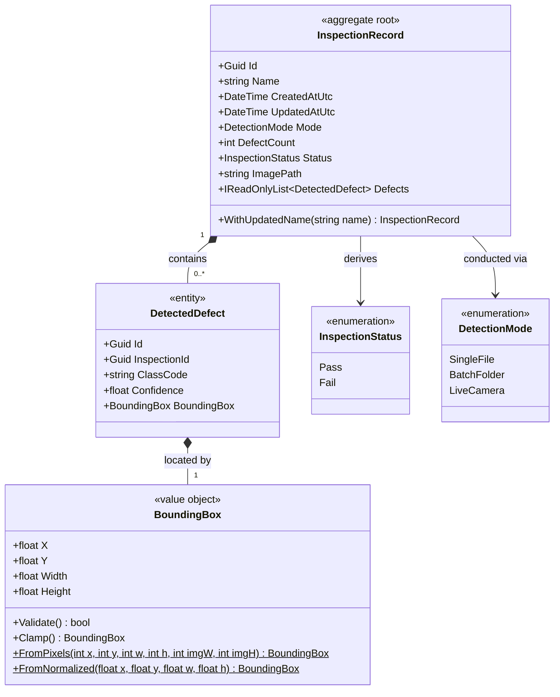
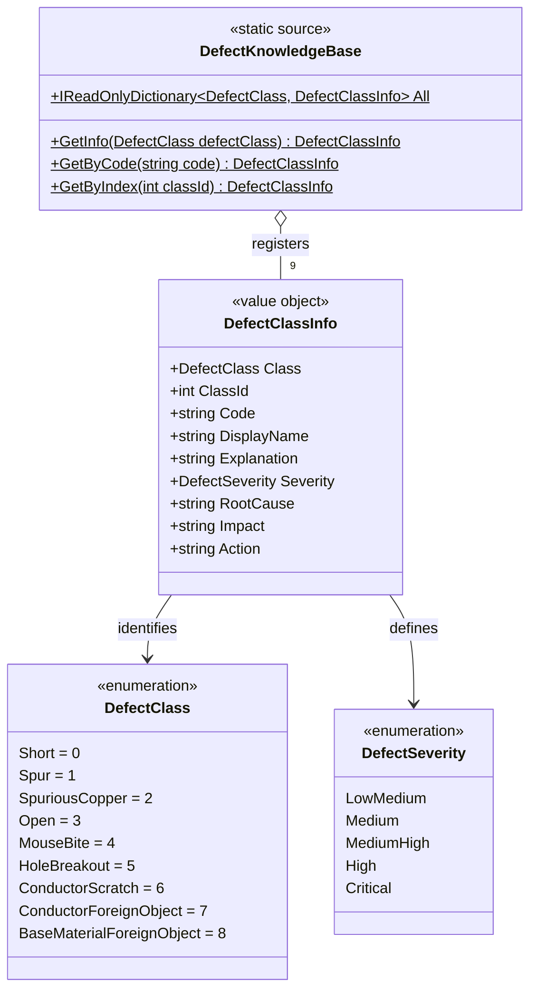
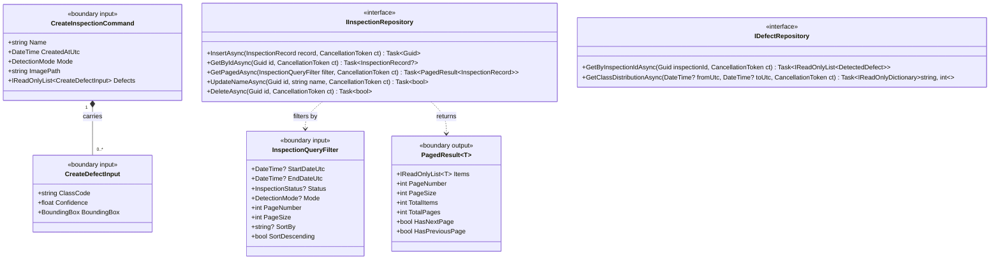

# Domain Model & Interface Contracts: Phase 2

This document defines the domain models, value objects, static knowledge base, and application boundary contracts for the PCB defect detection system. It is structured into three focused, purpose-built diagrams following the **Single Responsibility Principle** and `api-and-interface-design`.

---

## 1. Core Inspection Aggregate

The Inspection Aggregate encapsulates the execution and capture lifecycle of a PCB inspection event.

### Invariants & Responsibilities
- **`InspectionRecord` (Aggregate Root):** Maintains aggregate integrity. `Status` is an immutable derived property (`DefectCount == 0 ? Pass : Fail`), preventing status desynchronization bugs.
- **`DetectedDefect` (Entity):** Stores per-detection bounding coordinates and model confidence. Diagnostic properties (`Explanation`, `Severity`, `RootCause`, `Impact`, `Action`) are delegated dynamically to the static `DefectKnowledgeBase`.
- **`BoundingBox` (Value Object):** Enforces spatial validation (`[0.0, 1.0]`) and provides factory methods for pixel-to-normalized coordinate conversion.

---

## 2. Defect Classification & Static Knowledge Base

Encapsulates the 9 defect classes and static diagnostic guidance (`DEFECT_KB`), providing instant, type-safe lookups without database text duplication.

### Knowledge Base Properties
- **`DefectClass` Enum:** Integer values `0` through `8` matching model tensor output indices (`CLASS_NAMES`).
- **`DefectSeverity` Enum:** Standardized severity grading (`Critical`, `High`, `Medium-High`, `Medium`, `Low-Medium`).
- **`DefectKnowledgeBase`:** Centralized, immutable reference source mapping each class code to full diagnostic guidance.

---

## 3. Application Boundaries & Repository Contracts

Separates external input commands and paginated query results from internal domain aggregates per `api-and-interface-design`.

### Boundary & Interface Rules
- **Input Isolation:** Callers provide operational values (`CreateInspectionCommand`). Database-generated keys and derived statuses are managed by aggregate roots.
- **Bounded Pagination:** `InspectionQueryFilter` bounds page requests (`PageSize` default 20, max 100) to protect database memory and query latency.
- **Contract-First Persistence:** Repositories expose explicit async contracts returning nullable entities (`GetByIdAsync`) or structured paged results (`GetPagedAsync`).
