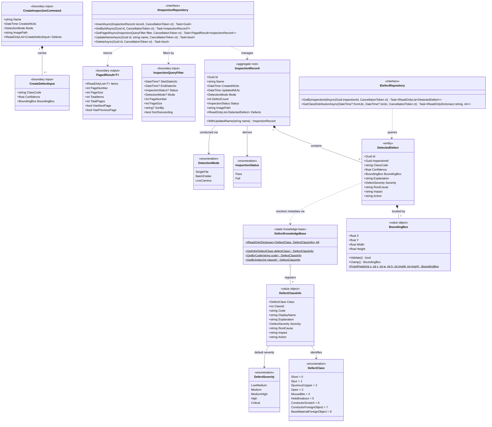

# Domain Model & Interface Contracts: Phase 2

This document defines the core domain entities, value objects, enumerations, input/output boundary contracts, repository interfaces, and relationships for the PCB defect detection system, designed in accordance with `api-and-interface-design`.

---

## Architectural & Interface Design Principles (Per `api-and-interface-design`)

### 1. Contract-First & Input/Output Boundary Separation
- **Input Contracts (`CreateInspectionCommand`, `CreateDefectInput`):** Callers submit minimal inputs. System fields (`Id`, `CreatedAtUtc`, `UpdatedAtUtc`, computed `Status`, `DefectCount`) are maintained by domain aggregate roots.
- **Query Contracts (`InspectionQueryFilter`, `PagedResult<T>`):** All collection queries are explicitly paginated with bounded defaults (`PageSize` default = 20, max = 100) to protect memory and query performance.
- **Output Types (`InspectionRecord`, `DetectedDefect`):** Immutable view models exposed to presentation, dashboard, and export layers.

### 2. Normalized Entities with Static Knowledge Base Delegation
- **`DetectedDefect`:** Stores only variable per-detection data (`Id`, `InspectionId`, `ClassCode`, `Confidence`, `BoundingBox`).
- **Centralized Static Source (`DefectKnowledgeBase`):** All descriptive metadata (`Explanation`, `Severity`, `RootCause`, `Impact`, `Action`) is maintained in a centralized static source (`DEFECT_KB`), preventing text duplication across database rows while providing instant, type-safe lookup.
### 3. Immutability & Value Object Encapsulation
- **`BoundingBox`:** Implements strict validation ensuring coordinates remain normalized within `[0.0, 1.0]`. Provides factory methods (`FromPixels`, `FromNormalized`) and safe clamping utilities to guarantee valid bounding geometry at system edges.
- **`InspectionRecord`:** Status is an immutable computed property (`DefectCount == 0 ? Pass : Fail`), preventing status desynchronization bugs.
